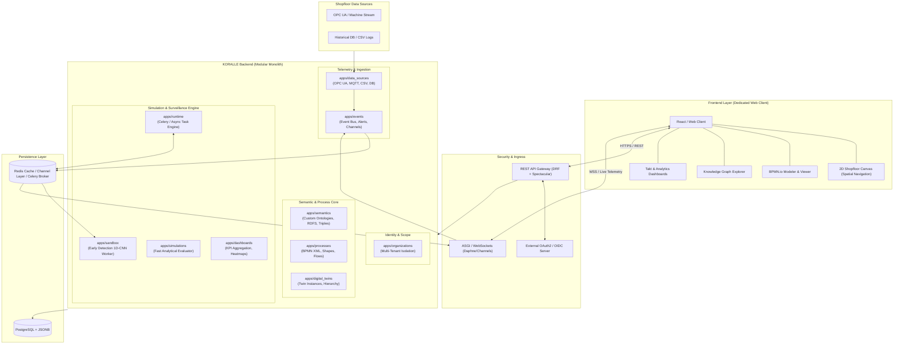

# KORALLE Platform: Mission, Architecture & Technical Goals

## 1. Overview & Mission Statement

The **KORALLE Platform** is a multi-tenant, cloud-ready digital twin and shopfloor intelligence system. It unifies:
1. **Semantic Knowledge Graphs (RDFS / Custom Ontologies)**: Representing plant topologies, hierarchical machine assets, materials, sensors, and causal relationships.
2. **Process Modeling (BPMN 2.0)**: Descriptive, easily editable process diagrams mapping manufacturing cycles, material flow, and dependencies.
3. **2D Shopfloor Visualization**: Interactive spatial mapping allowing operators to inspect plants, drill down from plant to assembly lines and individual stations, and navigate underlying semantic graphs.
4. **Hybrid Analytical Simulation**:
   - **Fast Analytical Twin**: Instant formula-driven evaluation of cycle times, disturbances, and KPIs (inspired by `SemDT` and discrete graph simulations).
   - **Continuous Surveillance & Early Detection**: Background streaming inference (integrating the 1D-CNN failure prediction from `KORALLE-Sandbox`) to detect station disruptions 10–30 minutes in advance.
5. **Real-Time Telemetry & Dashboards**: Sub-second shopfloor streaming via WebSockets to feed live KPIs, takt stabilization metrics, and operational alarms.

---

## 2. Target System Architecture

---

## 3. Core Architectural Principles

### 3.1 Multi-Tenant Isolation
- Every domain entity belongs to an `Organization`.
- Database queries and API endpoints enforce tenant scoping (`organization_id`) automatically via middleware and custom querysets.
- Cross-tenant data leakage is strictly forbidden.

### 3.2 Relational Graph & Semantic Storage (PostgreSQL)
- Semantic data is stored natively in PostgreSQL using a hybrid model:
  - Relational `OntologyNode` and `OntologyEdge` models for graph traversals and relational integrity.
  - JSON-LD / `jsonb` representation for flexible properties, context definitions, and fast schema exports.
- Eliminates the operational overhead of a separate triplestore while ensuring sub-millisecond hierarchical lookups.

### 3.3 Descriptive BPMN & Layout Synchronization
- BPMN models are treated as first-class domain assets, storing raw XML alongside parsed structural elements (`nodes`, `flows`, `shapes`, and `waypoints`).
- Elements are mapped directly to semantic twin nodes (e.g., BPMN Task $\leftrightarrow$ Station in the knowledge graph).

### 3.4 Dual Simulation & Analytics Strategy
1. **Synchronous Analytical Engine (`apps/simulations`)**:
   - Ported and enhanced from `koralle/SemDT`.
   - Evaluates dependency formulas in AST sandbox mode for quick what-if evaluations and parameter changes.
2. **Asynchronous Streaming Analytics (`apps/runtime` & `apps/sandbox`)**:
   - Dedicated Celery/Redis background worker running the pre-trained PyTorch 1D-CNN surveillance engine from `KORALLE-Sandbox`.
   - Emits early disruption alarms over Redis channels to be broadcast via WebSockets.

---

## 4. Integration Blueprint for Sibling Repositories

| Sibling Source | Source Module | Target KORALLE App | Integration Plan |
| :--- | :--- | :--- | :--- |
| **`SemDT`** | `core.py` (SafeEvaluator, JSON-LD exporter) | `apps/simulations` & `apps/semantics` | Extract formula evaluator into a reusable service; convert JSON-LD exporter to read from PostgreSQL models. |
| **`SemDT`** | `web.py` & BPMN XML parser | `apps/processes` | Migrate BPMN XML parsing into Django services with model validation and diagram serialization. |
| **`KORALLE-Sandbox`** | `early_detection_standalone/` | `apps/sandbox` & `apps/runtime` | Integrate the 1D-CNN streaming engine as an async Celery worker or microservice daemon feeding `apps/events`. |
| **`KORALLE-Sandbox`** | `bpmn_to_ttl.py` & `.ttl` ontologies | `apps/semantics` | Ingest MAGNA & CPT ontology definitions into seed fixtures for custom domain ontologies. |
| **`KORALLE-bpmn-graph-sim`** | `bpmn_parser.py`, `graph_structure.py` | `apps/processes` & `apps/simulations` | Utilize graph conversion algorithms to calculate process critical paths, bottlenecks, and wasted time. |

---

## 5. Phased Implementation Roadmap

### Phase 1: Dependency & Foundation Setup
- [ ] Initialize standard `pyproject.toml` (or locked `requirements.txt`) with DRF, `drf-spectacular`, `django-cors-headers`, `channels`, `celery`, `redis`, `psycopg`.
- [ ] Stabilize `settings.py` (logging paths, dev/prod environments, PostgreSQL/SQLite fallback).
- [ ] Verify `python manage.py check` passes with zero errors.

### Phase 2: Domain Schema & Migrations
- [ ] **`organizations`**: Implement `Organization` and membership/tenancy models.
- [ ] **`digital_twins`**: Implement twin asset hierarchy (Plant -> Line -> Station).
- [ ] **`semantics`**: Implement `Ontology`, `Concept`, and `Relation` models with JSON-LD export.
- [ ] **`processes`**: Implement `ProcessModel` (BPMN XML, parsed nodes/edges, visual metadata).
- [ ] Generate initial database migrations.

### Phase 3: Service Layer & Simulation Engines
- [ ] Integrate `SemDT`'s AST formula evaluation into `apps/simulations/services.py`.
- [ ] Port BPMN graph conversion logic from `KORALLE-bpmn-graph-sim`.
- [ ] Build REST API ViewSets and expose OpenAPI documentation via `/api/schema/swagger-ui/`.

### Phase 4: Real-Time Telemetry & Early Detection
- [ ] Configure Django Channels / ASGI for WebSocket streaming.
- [ ] Integrate the `early_detection_standalone` PyTorch inference pipeline into `apps/runtime`.
- [ ] Establish telemetry ingestion endpoints (`apps/data_sources`) streaming live alerts to WebSockets.

### Phase 5: Verification & UI Integration
- [ ] Implement end-to-end integration tests (`pytest-django`).
- [ ] Expose 2D shopfloor coordinates and hierarchical navigation endpoints.
- [ ] Connect and verify against the dedicated web frontend.
